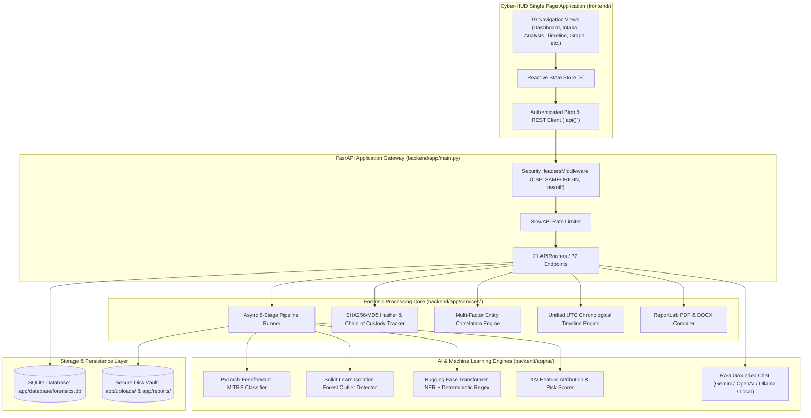

# T.A.C.T.I.C. — AI Digital Forensics Assistant

An enterprise-grade, AI-powered digital forensics investigation platform built for security analysts, incident responders, and forensic investigators. T.A.C.T.I.C. automates evidence ingestion, cryptographic hashing, entity extraction, anomaly detection, entity correlation, attack timeline reconstruction, human-in-the-loop finding review, and audit report generation.

---

## Quickstart Guide

### Prerequisites
- Python 3.10+ (tested on Python 3.11 - 3.13)
- Modern web browser (Chrome, Firefox, Edge, Safari)

### 1. Installation

Clone the repository and install dependencies:

```bash
git clone https://github.com/asashish001/TACTIC.git
cd TACTIC
pip install -r requirements.txt
```

### 2. Configure Environment

Copy the template configuration:

```bash
cp .env.example .env
```

Key environment variables:
| Variable | Description | Default |
| :--- | :--- | :--- |
| `SECRET_KEY` | JWT signing secret key | *(auto-generated if unset)* |
| `JWT_SECRET_KEY` | Dedicated refresh token signing secret | *(uses `SECRET_KEY` if unset)* |
| `ACCESS_TOKEN_EXPIRE_MINUTES` | Access token lifetime in minutes | `480` (8 hours) |
| `REFRESH_TOKEN_EXPIRE_DAYS` | Refresh token lifetime in days | `7` |
| `CORS_ORIGINS` | Allowed origins (comma-separated) | `http://localhost:8000,http://127.0.0.1:8000` |
| `MAX_UPLOAD_BYTES` | Maximum upload file size in bytes | `524288000` (500 MB) |
| `DEFAULT_TIMEZONE` | Normalization fallback timezone | `UTC` |
| `DATABASE_URL` | SQLite database URI | `sqlite:///app/database/forensics.db` |
| `DEFAULT_ADMIN_USERNAME` | Default admin username | `admin` |
| `DEFAULT_ADMIN_PASSWORD` | Default admin password | `ChangeMe123!` |
| `AI_PROVIDER` | AI provider for chat (`gemini`, `openai`, `ollama`, `disabled`) | `disabled` |
| `NLP_MODEL_NAME` | HuggingFace NER model (`dslim/bert-base-NER` or `fallback`) | `dslim/bert-base-NER` |
| `THREAT_INTEL_REMOTE_LOOKUPS` | Enable external threat intelligence lookups | `false` |

### 3. Launch Application

Start the server using the root development launcher:

```bash
python app.py
```

Or run Uvicorn directly from the `backend/` directory:

```bash
cd backend
python -m uvicorn app.main:app --host 127.0.0.1 --port 8000 --reload
```

Navigate to **[http://127.0.0.1:8000](http://127.0.0.1:8000)**.  
**Default credentials**: `admin` / `ChangeMe123!`.

---

## Docker Deployment

To deploy in an isolated, containerized environment:

```bash
docker-compose up --build -d
```

The application will be accessible at `http://localhost:8000` with persistent volumes mounted for SQLite data, evidence uploads, and generated reports.

---

## Core Capabilities

### 1. Forensic Evidence Ingestion & Integrity
- **Stream-Safe Processing**: Direct disk-streaming upload handling large evidence files without memory spikes.
- **Cryptographic Triad**: Automatic computation of MD5, SHA-1, and SHA-256 hashes upon upload.
- **Immutable Chain of Custody**: Automatic verification of magic numbers, duplicate detection across investigations, and tamper-evident audit logging.
- **Authenticated Downloads**: Secure token-authorized downloads via blob URLs and strict path-traversal prevention.

### 2. 8-Stage Forensic Pipeline & Machine Learning
- **Stage 1 (Upload)**: Evidence staging and parameter validation.
- **Stage 2 (Hashing)**: Cryptographic checksum baseline calculation.
- **Stage 3 (Preprocessing)**: Deep metadata extraction (EXIF GPS, Office properties, PE headers, EVTX log records, `pypdf` parsing).
- **Stage 4 (Artifact Extraction)**: 13 entity types extracted via Hugging Face Transformer NER with regex fallback (IPs, URLs, emails, domains, file paths, processes, hostnames, timestamps, SIDs, UUIDs, commands, usernames, and forensic events). Supported by robust SQLAlchemy 2.0 `Mapped` schemas.
- **Stage 5 (Anomaly Detection)**: Unsupervised Scikit-Learn Isolation Forest outlier analysis with XAI decision trees and feature attribution bar charts.
- **Stage 6 (Correlation)**: Multi-factor entity relationship mapping with normalized confidence scores.
- **Stage 7 (Timeline)**: Unified UTC chronological ordering across heterogeneous evidence sources.
- **Stage 8 (Reporting)**: Publication-grade PDF and DOCX compilation.

### 3. Human-in-the-Loop Finding Review
- **Tinder-like Review Queue**: Interactive Triage Queue with fluid swipe animations to **Approve** or **Reject** automated findings.
- Tracks reviewer user ID, timestamps, and justification notes in compliance with forensic audit standards.
- Findings dynamically update their `review_status` in the backend before being finalized in the report.

### 4. Grounded AI Assistant (RAG)
- Context-bounded investigation assistant querying case-specific evidence and findings.
- Deep Semantic Search: Uses local Snowflake (arctic-embed) models to dynamically retrieve and prioritize the most relevant evidence for your specific query.
- Multi-provider support: Google Gemini, OpenAI, Ollama (local), or deterministic rule summary fallback.
- **Real-time Server-Sent Events (SSE)**: Streams chat responses instantaneously using persistent HTTP connections for fluid conversation.
- Real-time anti-hallucination validation verifying all mentioned entities against known case artifacts.

### 5. Native Desktop-Like UX
- **Dynamic Chart.js Visualizations**: Dashboard natively renders Timeline Event bar charts and Evidence Type donut charts.
- **Contextual Right-Click Menus**: Native-feeling context menus in the Evidence Locker and Network Graph (e.g., "Send to AI Chat").
- **Column-level Data Filtering**: Sticky table headers with embedded multi-column search and sorting.
- Lightning-fast Server-Sent Events (SSE) streaming for long-running analysis jobs without polling overhead.

### 6. Enterprise Authentication, RBAC & Workstation Security
- **JWT Token Rotation & Revocation**: Short-lived access tokens combined with single-use refresh token rotation and explicit server-side revocation on logout (`/api/auth/logout`).
- **Interactive Authentication Portal**: Glassmorphic portal supporting investigator registration with real-time password complexity validation.
- **Role-Based Access Control (RBAC)**: Role hierarchy (`admin`, `investigator`, `student`, `viewer`) safeguarding case access and sensitive actions.
- **Workstation Lockout**: Automatic 15-minute inactivity lock and manual lock with password-verified resumption and account switching.
- **Investigator Self-Service**: Embedded account overview and secure passphrase update endpoint (`/api/users/me/change-password`).


---

## Architecture Overview



---

## Repository Structure

```text
AI Digital Forensics Assistant/
├── .env.example                 # Environment configuration template
├── .gitignore                   # Clean Git ignore rules (caches, DBs, staging)
├── app.py                       # Root development launcher (port-probe & uvicorn)
├── docker-compose.yml           # Multi-container deployment config
├── README.md                    # Platform documentation
├── requirements.txt             # Root requirements pointer (-r backend/requirements.txt)
│
├── Special Docs/                # Project documentation, design, and roadmaps
│   ├── CLAUDE.md                # Agent rules, architecture invariants, & standards
│   ├── PRD.md                   # Product Requirements Document
│   ├── ROADMAP.md               # Future development plans & milestones
│   └── design.md                # System design and architecture details
│
├── backend/                     # Backend application root
│   ├── Dockerfile               # Production container definition (Python 3.11-slim)
│   ├── migrate.py               # Standalone database migration & setup helper
│   ├── mypy.ini                 # Static type checking configuration
│   ├── pytest.ini               # Pytest configuration & test markers
│   ├── requirements.txt         # Core dependencies (FastAPI, PyTorch, Transformers, etc.)
│   │
│   ├── app/                     # Application source package
│   │   ├── ai/                  # AI models (threat classifier, anomaly detector, NER, XAI)
│   │   ├── api/                 # 21 modular FastAPI routers (auth, evidence, analysis, etc.)
│   │   ├── auth/                # JWT security, TOTP MFA, password hashing, RBAC role checkers
│   │   ├── config.py            # Global application settings & rate limits
│   │   ├── database/            # SQLAlchemy session management & forensics.db
│   │   ├── main.py              # ASGI application bootstrap & middleware
│   │   ├── models/              # 15 SQLAlchemy ORM models with cascade integrity
│   │   ├── reports/             # Generated PDF and DOCX reports by case
│   │   ├── schemas/             # Pydantic request/response validation models
│   │   ├── services/            # Pipeline runner, integrity verifier, correlation engine
│   │   ├── startup.py           # DB migrations, admin seeding, security sanity checks
│   │   ├── uploads/             # Case-isolated evidence disk vault
│   │   └── utils/               # PDF/Word generators and formatting helpers
│   │
│   └── tests/                   # Automated test suite (115+ automated tests passing 100%)
│       ├── conftest.py          # Shared fixtures, in-memory DB, offline test settings
│       ├── test_auth_endpoints.py # Registration, login, token refresh, and logout tests
│       ├── test_refresh_token_rotation.py # Token rotation & theft detection tests
│       ├── test_api_integration.py
│       ├── test_async_job_processing.py
│       ├── test_concurrent_uploads.py
│       ├── test_integrity_verification.py
│       ├── test_forensic_timeline_engine.py
│       ├── test_live_server_api.py
│       └── ...
│
├── frontend/                    # Frontend client
│   ├── index.html               # High-performance Vanilla Cyber-HUD SPA
│   ├── styles.css               # Design system & cyber-forensics theme tokens
│   ├── logo.jpg                 # TACTIC branding asset
│   └── js/                      # Modular client application logic
│       ├── app.js               # Application coordinator & routing
│       ├── auth.js              # Token management, login portal, user state
│       ├── api.js               # Authenticated REST client with auto-refresh rotation
│       ├── session.js           # Idle timer & workstation lock manager
│       ├── state.js             # Reactive global state store
│       ├── tables.js            # Column-level data filtering & sorting
│       ├── cases.js             # Case lifecycle management
│       ├── evidence.js          # Ingestion & file streaming
│       ├── dashboard.js         # Forensic overview metrics & Chart.js
│       ├── analysis.js          # Pipeline triggers & findings
│       ├── triage.js            # Human-in-the-loop review queue
│       ├── timeline.js          # Chronological event visualization
│       ├── network.js           # Cytoscape relationship graph
│       ├── chat.js              # Streaming RAG assistant interface
│       ├── reports.js           # Document export generators
│       ├── settings.js          # System parameters & account security
│       └── ui.js                # Toasts, context menus, and DOM utilities
│
├── scripts/                     # Operational & dependency audit scripts
│   ├── audit-deps.sh
│   └── seed_network.py
│
└── test_data/                   # Sample forensic artifacts for testing
    ├── browser_bookmarks.json
    ├── chrome_120.0.1.log
    ├── firewall_traffic.csv
    ├── invoice.pdf.exe
    └── network_observations.log
```

---

## Testing

Run the automated pytest suite:

```bash
cd backend
python -m pytest tests/ -v
```

To run only unit and asynchronous pipeline tests:

```bash
cd backend
python -m pytest tests/ -q -m "not integration"
```

To run live server verification:

```bash
cd backend
python tests/test_live_server_api.py
```

---

## Key API Endpoints

Interactive Swagger documentation is available at **`http://127.0.0.1:8000/docs`**.

| Endpoint | Method | Role | Description |
| :--- | :--- | :--- | :--- |
| `/api/auth/register` | POST | Public | Register new investigator account |
| `/api/auth/login` | POST | Public | Authenticate credentials & issue JWT tokens |
| `/api/auth/refresh` | POST | Public | Rotate refresh token for new token pair |
| `/api/auth/logout` | POST | Public | Invalidate refresh token and terminate session |
| `/api/users/me` | GET | Authenticated | Retrieve active investigator profile |
| `/api/users/me/change-password` | POST | Authenticated | Change investigator passphrase |
| `/api/auth/totp/setup` | POST | Authenticated | Generate TOTP MFA secret & provisioning URI |
| `/api/auth/totp/verify` | POST | Authenticated | Confirm TOTP MFA token and activate protection |
| `/api/auth/totp/disable` | POST | Authenticated | Disable TOTP MFA with current password |
| `/api/cases` | GET/POST | Analyst | List cases or create a new case |
| `/api/cases/{id}` | GET/PUT/DELETE | Analyst | Retrieve, update, or cascade-delete a case |
| `/api/evidence` | GET | Analyst | Paginated evidence items by case |
| `/api/evidence/upload` | POST | Analyst | Ingest, hash, and preserve evidence |
| `/api/evidence/download/{id}` | GET | Analyst | Stream authenticated evidence binary |
| `/api/analyze` | POST | Analyst | Trigger 8-stage forensic pipeline (case or evidence) |
| `/api/analyze/findings/{case_id}` | GET | Analyst | List findings for human review |
| `/api/analyze/findings/{id}/review` | PUT | Analyst | Approve, reject, or escalate a finding |
| `/api/timeline/{case_id}` | GET | Analyst | Retrieve unified chronological timeline |
| `/api/correlation/{case_id}` | GET | Analyst | Fetch cross-evidence relationship graph |
| `/api/chat` | POST | Analyst | Context-grounded RAG forensic assistant |
| `/api/chat/stream` | POST | Analyst | Server-Sent Events (SSE) stream for RAG assistant |
| `/api/jobs/case/{case_id}/stream` | GET | Analyst | Server-Sent Events (SSE) stream for job progress |
| `/api/report` | GET/POST | Analyst | Generate PDF or Word forensic reports |
| `/api/report/download/{id}` | GET | Analyst | Stream authenticated report document |
| `/api/health` | GET | Public | System health, memory, and storage metrics |

---

## License

This project is developed for digital forensics research, education, and incident response operations.
